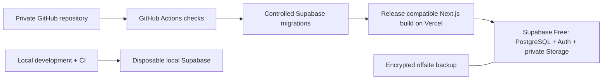

# Agile Project — Team Fire: deployment plan

Status: planned runbook, not a record of a completed deployment. Hosting is fixed to Supabase Free + Vercel as requested. Application code, migrations, workflows, and scripts described here must be implemented before these steps can run.

## 1. Deployment topology

Repository: [Asadjafri9/agile-project-team-fire](https://github.com/Asadjafri9/agile-project-team-fire). Keep it private. A private repository does not by itself protect a deployed website: every protected application route and backend data path needs authentication/authorisation.

Use local Supabase for development and isolated CI. The initial free setup has one hosted Supabase project for the demo. Do not require paid database branching. If a separate hosted test project fits the provider's account allowance, it can be added, but it is not assumed by this plan. Select a supported backend region near the intended users and place the Vercel server runtime nearby where the plan allows; benchmark from Pakistan rather than assuming a region's latency.

## 2. Accounts and configuration

1. Repository owner connects the private personal GitHub repository to Vercel with the minimum required repository access.
2. Create the Supabase Free project; store the database password and administrative credentials in an operator secret store.
3. Record the project URL, publishable key, project reference, region, and Auth redirect configuration.
4. Disable public signup. Provision synthetic username/password Auth accounts using restricted tooling, not SQL writes to Supabase-managed auth tables. Keep a deploy operator account separate from application test users.
5. Create the private attachment bucket via migration/configuration, with a 10 MB limit and approved types. Apply tested Storage policies before any user upload.
6. Set Vercel production environment variables and a stable initial `*.vercel.app` origin. A custom domain is optional. Allow only intended Auth callback origins; do not broadly allow arbitrary preview URLs.

| Variable | Scope | Purpose |
| --- | --- | --- |
| `NEXT_PUBLIC_SUPABASE_URL` | Browser/server | Hosted API endpoint. |
| `NEXT_PUBLIC_SUPABASE_PUBLISHABLE_KEY` | Browser/server | Public key; access depends on JWT, grants, and RLS. |
| `APP_ORIGIN` | Server | Canonical deployed origin and mutation-origin validation. |
| `SUPABASE_PROJECT_REF` | Operator/CI only | Migration target. |
| `SUPABASE_ACCESS_TOKEN` | Operator/CI only | CLI authentication; restricted deployment context. |
| `SUPABASE_DB_PASSWORD` | Operator/CI only | CLI migration/database access. |
| `SUPABASE_SERVICE_ROLE_KEY` | Restricted provisioning context only | Create/reset known accounts; never a regular runtime credential. |

No runtime service-role key is necessary for normal reads, RPC writes, login, or private file transfer. Public variables are intentionally public; secrets are not. `.env.example` contains placeholders only, `.env.local` is ignored, and example passwords are not real accounts. Never give production secrets to untrusted PR jobs.

Username login uses the internal invalid-domain adapter in [architecture.md](architecture.md). Supabase's default SMTP is restricted and is not a dependable invitation/recovery channel. This release uses no outbound email: existing accounts receive in-app invitations, and an operator handles provisioning/recovery. If email registration/recovery is later requested, configure and test custom SMTP before enabling it. See [Supabase SMTP documentation](https://supabase.com/docs/guides/auth/auth-smtp).

## 3. Local development and CI

During implementation, define scripts for `dev`, `lint`, `typecheck`, `test`, `test:e2e`, and `build`; these do not exist yet. Install a supported Node LTS, the locked package manager, Docker, and Supabase CLI.

Local workflow:

1. Install locked dependencies and start local Supabase.
2. Reset the local database from committed migrations and synthetic seed data.
3. Generate database TypeScript types and verify the committed output matches.
4. Provision local users through local Auth, taking passwords from a local secret or runtime generator.
5. Run the app with local Supabase URL/keys; local credentials must never target production.
6. Run backend permission/concurrency tests and the main browser journeys.

Pull request checks:

- Frozen-lockfile dependency install; lint, strict typecheck, unit checks, and production build.
- Fresh local Supabase; migrations, SQL privilege/RLS tests, transactional lifecycle/concurrency scenarios, and generated-type drift check.
- Playwright journeys for login, isolated projects, backlog → sprint → board → complete → export, and Viewer restrictions.
- Secret/dependency scanning appropriate to the repository; failures are resolved before release.

Backend tests must call RPCs and Data API as anonymous/users of each role, including direct requests that bypass Next.js. A green frontend build alone is not a security test. Use independent database sessions for actual concurrent transaction scenarios.

## 4. First hosted deployment — Sprint 0

1. Build a minimal protected application shell, health endpoint, schema/history foundation, and RLS/RPC policies before importing a deployable build.
2. Run all checks against a clean local database. Take a pre-change export of any existing hosted data.
3. Link CLI to the intended Supabase project and review pending migrations and grants. Apply migrations through the controlled release workflow, not during `next build` or a Vercel preview build.
4. Import the GitHub repository into Vercel, choose the Next.js framework settings, and supply production variables. Disable automatic production promotion until the release gates below are configured.
5. Deploy a checked build compatible with the deployed schema. Enable HTTPS; set exact Auth site/redirect configuration after the origin is known.
6. Run a safe smoke test: health response, login/logout, unauthorised denial, cross-project denial, one sample write with history, and private-file denial. Health responses expose no credentials or schema details.
7. Tag the successful release and record commit SHA, migration versions, build URL, deployment time, and operator in process evidence.

## 5. Ongoing release ordering

Do not race Vercel's Git auto-deployment against a separate database migration job. Choose one release mechanism that enforces this order:

`checks pass → backup → additive migration → deploy compatible build → hosted smoke check → mark release`

Use a GitHub Actions release job with a concurrency group so two database deployments never overlap. Keep production deployment secrets in its protected environment. Configure Vercel deployment so the new application is only promoted after checks/migrations; otherwise a new route may start before its RPC exists. Use expand/contract migrations: add structures first, deploy compatible code, remove old structures in a later release.

Preview deployments never receive production write credentials or point at the production Supabase backend. If no isolated hosted test backend is available, disable protected preview flows or use a separately configured synthetic preview environment; run full backend integration in local CI. Initial Vercel imports can auto-create previews, so configure environment scopes before connecting deployable branches.

Rollback: redeploy the last compatible frontend build; prefer a forward database correction. Do not automatically reverse migrations containing snapshots/history or user data. If a migration affects data destructively, restore into an isolated database first and verify recovery before changing the hosted project.

## 6. Free-hosting constraints that affect this project

- Vercel Hobby is limited to personal, non-commercial use. Verify the course project fits those terms; a commercial launch would need a different hosting decision. See [Vercel Hobby](https://vercel.com/docs/plans/hobby).
- Vercel's private-repository deployment rules restrict Hobby deployment authors, and private organisation repositories have additional restrictions. This is currently a personal private repository. Use the legitimate owner deployment path for a course demo and verify actual collaborator behaviour before depending on each member's push to deploy; do not rewrite authors to bypass restrictions. See [Git deployment rules](https://vercel.com/docs/git).
- Supabase Free may pause inactive projects and does not supply the same backup access as paid plans. Restore/check the project before the assessment and keep independent exports. See [Supabase production checklist](https://supabase.com/docs/guides/deployment/going-into-prod).
- Database, file storage, egress, Auth, function, and hosting usage remain subject to provider limits. Check current account dashboards during setup rather than hard-coding a supposed permanent quota or guaranteeing unlimited concurrency.
- Compact polling and paginated queries reduce avoidable work; compare measured usage with available free allowance. Send attachment bytes directly to Storage. Keep PDFs bounded to one sprint and use the Node runtime.
- Do not create cron traffic simply to bypass inactivity policies. A demo-readiness check by the team is sufficient.

## 7. Backups, recovery, and credentials

Take an encrypted database export at least daily while the team is actively collecting assessment evidence and before migrations. Back up private file bytes separately with object paths/checksums; database metadata alone does not contain uploaded files. Keep backups outside the repository and outside the hosted project, with restricted access. Store migration/config versions and a manifest linking the database export to its file backup.

Auth identities and secrets need an explicit recovery plan: verify which Auth-managed data the chosen dump/restore method includes, and document account reprovisioning/password resets if it does not. Do not claim a plain public-schema dump restores login accounts. Never commit a raw auth dump or passwords.

Proposed course target: at most 24 hours lost data and restore within four hours. Prove this with a disposable local recovery: apply compatible schema, restore authorised domain/Auth data or reprovision accounts, restore files, recheck ID references/permissions, and compare sprint metrics with saved exports. Record the measured result. A backup without a restore drill does not satisfy OPS-01.

For forgotten passwords, verify the person's identity through the course team, use restricted Auth admin tooling to set a new temporary password, deliver it privately, record only the reset event, and require the user to change it. Never retrieve an existing password. Remove unused admin tokens after provisioning and rotate exposed credentials immediately.

## 8. Assessment readiness

- Hosted project is active, login works, and no provider quota blocks the demo.
- Assessor credentials were shared privately; Viewer and editing examples have appropriate roles.
- Synthetic dataset includes real event history and scope changes; charts are generated from it.
- Two browser sessions demonstrate concurrent edits, visible board updates, and an explicit same-card conflict.
- Completed-sprint PDF/CSV metrics match the UI and remain unchanged after later item changes.
- Authenticated attachment access succeeds, and anonymous/cross-project access fails.
- Backup restore, UAT, performance observations, and per-sprint artefacts are recorded.
- GitHub repository remains private; the latest release refers to a passing commit.
