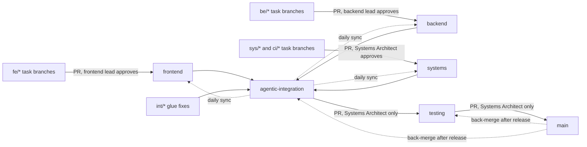

# Branching and promotion model

Owner: Systems Architect · Decision record: [ADR-011](../adr/011-agentic-branch-model.md) · Agent rules: [AGENTS.md](../../AGENTS.md)

## 1. The six permanent branches



| Branch | Holds | Deploys to | Merged by |
| --- | --- | --- | --- |
| `main` | Production release — what assessors use | Production Vercel + production Supabase | Systems Architect, from `testing` only |
| `testing` | Release candidate under live tests | Staging Vercel + staging Supabase (second free project) | Systems Architect, from `agentic-integration` only |
| `agentic-integration` | All departments' work bound together; integration errors found and raised issues verified closed here | Nothing (CI only, against a local Supabase) | Integration agent |
| `frontend` | Active frontend development | Nothing | Frontend lead |
| `backend` | Active backend development | Nothing | Backend lead |
| `systems` | Architecture, ADRs (Architecture Decision Records), `AGENTS.md`, CI/CD (Continuous Integration / Continuous Delivery) workflows, scripts, milestones, branch registry, integration log | Nothing | Systems Architect |

Governance files (`AGENTS.md`, `docs/**`, `.github/**`) are authored on `systems` and reach every other branch through `agentic-integration` → daily sync. That way every agent, on every branch, reads the same rules.

## 2. Task branches

| Prefix | Created from | PR into | Example |
| --- | --- | --- | --- |
| `fe/` | `frontend` | `frontend` | `fe/BOARD-02-card-drag` |
| `be/` | `backend` | `backend` | `be/SPR-04-start-sprint-rpc` |
| `sys/` | `systems` | `systems` | `sys/adr-014-search-index` |
| `ci/` | `systems` | `systems` | `ci/release-job` |
| `int/` | `agentic-integration` | `agentic-integration` | `int/fix-import-paths` |

Naming: `<prefix>/<requirement-or-ticket>-<short-slug>`, lowercase, hyphens. Keep them short-lived (under about three days).

## 3. Allowed pull-request flows

Enforced by [`scripts/branch-guard.sh`](../../scripts/branch-guard.sh) in the `branch-guard` workflow. Anything not listed fails.

| Into | Allowed from |
| --- | --- |
| `main` | `testing` |
| `testing` | `agentic-integration`, `main` (back-merge) |
| `agentic-integration` | `frontend`, `backend`, `systems`, `int/*`, `testing` / `main` (back-merge) |
| `frontend` | `fe/*`, `agentic-integration` (sync), `main` |
| `backend` | `be/*`, `agentic-integration` (sync), `main` |
| `systems` | `sys/*`, `ci/*`, `agentic-integration` (sync), `main` |

Task-branch PRs are also path-checked against the ownership map in AGENTS.md §7.

## 4. Release cycle

1. Task branches merge into their department branches during the sprint.
2. When a department reaches a stable point, its human asks the Integration agent to merge it into `agentic-integration`. The merge is logged in [integration-log.md](integration-log.md).
3. The Integration agent runs the full suite and verifies open issues. When everything is green and no `blocker` / `type:security` issues are open, it files a promotion request.
4. The Systems Architect opens and merges `agentic-integration` → `testing`. The staging deployment updates; live tests and the manual smoke checklist run against staging.
5. The Systems Architect opens and merges `testing` → `main`, following `deployment.md` §5 order (backup → additive migration → deploy → smoke check → tag).
6. Back-merge `main` → `testing` → `agentic-integration`; department branches pick it up at their next daily sync.

Hotfixes use the same path, fast-tracked: `be/hotfix-…` → `backend` → `agentic-integration` → `testing` → `main` on the same day. There is no shortcut into `main`.

## 5. One-time setup checklist (humans only)

These need repository-admin or owner access. Agents must not attempt them.

**GitHub (repository owner — Asad)**
- [ ] Claim GitHub Pro free through the [GitHub Student Developer Pack](https://education.github.com/pack). On GitHub Free, protected branches do not work on private repositories, so every rule here would be advisory only.
- [ ] Add a branch rule for `main` and `testing`: require a PR, require 1 approval, require status checks (`branch-guard`, and later `ci`), block force-push and deletion, and restrict who can push to the Systems Architect and the owner.
- [ ] Add a branch rule for `agentic-integration`, `frontend`, `backend`, `systems`: require a PR, require `branch-guard`, block force-push and deletion.
- [ ] Settings → General → Pull Requests: allow merge commits; disable squash on `testing` and `main` so back-merges stay clean.
- [ ] Run `scripts/setup-github.sh` once to create the issue labels (needs triage access).

**Supabase**
- [ ] The Free plan allows two active projects. Create `team-fire-prod` and `team-fire-staging`. Never share credentials between them. Free projects pause after a week of inactivity, so wake staging before test sessions.

**Vercel (repository owner)**
- [ ] Production branch = `main`. Add a second environment (or a branch-scoped preview) for `testing` pointing to staging Supabase.
- [ ] Settings → Git → Ignored Build Step, so no other branch deploys:
  ```bash
  if [ "$VERCEL_GIT_COMMIT_REF" = "main" ] || [ "$VERCEL_GIT_COMMIT_REF" = "testing" ]; then exit 1; else exit 0; fi
  ```
  (Exit code 1 means "build"; 0 means "skip".)
- [ ] Production keys are scoped to Production only; staging keys only to the `testing` environment.

## 6. Day-to-day commands for agents

```bash
# start a task (frontend example)
git fetch origin
git switch frontend && git pull
git switch -c fe/BOARD-02-card-drag

# before opening a PR — check you are allowed to
bash scripts/branch-guard.sh fe/BOARD-02-card-drag frontend origin/frontend...HEAD

# daily sync of a department branch (done via a PR: agentic-integration → frontend)
```
