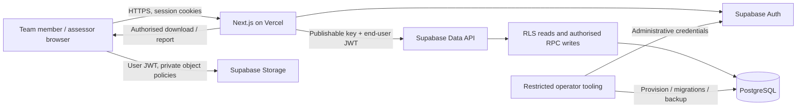
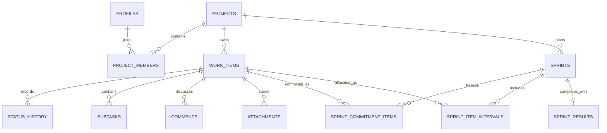

# Agile Project — Team Fire: system architecture

Status: proposed implementation design, aligned with the user's answers on 2026-10-21. Read [requirements.md](requirements.md) for scope and business rules and [deployment.md](deployment.md) for rollout. The repository currently contains documentation and the source PDF, not an implemented application.

## 1. Recommended stack

| Layer | Choice | Project-specific reason |
| --- | --- | --- |
| Language | TypeScript, strict mode | Shared client/server contracts and fast automated implementation. |
| Application | Next.js App Router + React, Node runtime | One deployable application for pages, protected API handlers, and exports. |
| UI | Tailwind CSS + shadcn/ui | Consistent design tokens, accessible base controls, fast screen development. |
| Forms/validation | React Hook Form + Zod | Typed user input and shared request schemas; SQL separately enforces invariants. |
| Drag/drop | dnd-kit's current React API | Sortable backlog and board; keyboard path and status menus remain available. |
| Server-state | TanStack Query | Optimistic updates, scoped caches, conflict rollback, compact polling. |
| Rich text | Tiptap with a restricted document schema | Structured descriptions without arbitrary HTML execution. |
| Charts | Recharts with accessible data tables | Burndown, velocity, and CFD from shared server-produced datasets. |
| Database | Supabase PostgreSQL | Transactions, relational constraints, history, SQL reporting, RLS. |
| Authentication | Supabase Auth + `@supabase/ssr` | Password/session management without writing credential storage. |
| Data access | `@supabase/supabase-js`, generated database types, SQL migrations/RPCs | Preserve end-user identity/RLS; transactional domain operations live next to data. |
| Files | Supabase Storage, private bucket | Project-scoped policies; direct uploads avoid routing file bytes through Vercel. |
| PDF / CSV | `@react-pdf/renderer`; explicit CSV serializer | Generate bounded reports without a headless browser; shared metrics source. |
| Tests | Vitest, PostgreSQL/pgTAP, Playwright | Domain calculations, actual permissions/concurrency, and browser journeys. |
| Delivery | GitHub Actions + Vercel + Supabase CLI | Reproducible checks, schema migrations, and frontend deployments. |

Use a supported Node LTS and stable compatible dependency releases at implementation time; pin versions and commit the lockfile. Do not install floating `latest` dependencies during CI. No separate Express/NestJS service, Redis, message broker, Kubernetes, ORM migration system, or custom WebSocket server is needed for this scope. SQL migrations are the sole schema authority. A separate backend would add deployment and authentication boundaries without removing the need for transactional database rules.

## 2. Runtime boundaries



The browser normally uses Next.js route handlers for domain reads/writes. It uses the Auth client for the documented session flow and the Storage client for authorised upload/download bytes. The Supabase endpoint and publishable key are public configuration; backend security must still hold when a user calls Supabase directly. Regular Next.js requests forward the user's JWT and never switch to a service-role client.

Read queries use database RLS plus server-side membership checks and minimal DTOs. All domain writes use narrowly scoped SQL RPCs, which enforce rules even if Next.js validation is bypassed. Database functions are an intentional privileged boundary and require explicit permissions tests. The Node process does not perform a sequence of unrelated REST writes and pretend it is a transaction.

## 3. Application modules and ownership

| Module | Responsibilities |
| --- | --- |
| Identity | Username login adapter, sessions, password change, provisioning runbook. |
| Projects | Projects, ownership, memberships, in-app invitations, role policy. |
| Backlog | Work items, criteria, subtasks, priorities, ordering, taxonomy. |
| Sprints | Capacity, allocation, immutable commitment, lifecycle, carryover. |
| Board | Versioned movements, ordering, optimistic reconciliation, WIP warnings. |
| Collaboration | Comments, mentions, in-app notifications, activity, attachments. |
| Analytics | Event replay, daily samples, completed results, report dataset. |
| Evidence | Export links and versioned process artefacts; no ceremony UI required. |

Proposed repository layout, to be created during implementation:

```text
src/
  app/(auth)/login/
  app/(workspace)/projects/[projectId]/
    backlog/  sprints/  board/  analytics/  settings/
  app/api/v1/                    # thin validated route handlers
  features/                     # modules listed above
  components/ui/
  lib/auth/                     # session verification and username adapter
  lib/supabase/                 # request-scoped server/browser clients
  lib/permissions/              # UI/server policy mirrors; DB authoritative
  lib/validation/
  lib/database.types.ts         # generated, committed
supabase/
  migrations/                   # schema, constraints, RPCs, RLS, grants
  tests/                        # pgTAP and transaction scenarios
  seed.sql                      # synthetic domain data, no passwords
scripts/                        # provisioning, backup, restore helpers
tests/e2e/
docs/adr/
docs/process/sprint-0/           # repeat directory for each delivery sprint
.github/workflows/
```

Keep feature modules independent of route layout. Backend contracts and SQL invariants should be settled before separate UI work begins so automated implementation cannot create competing schema or permission models.

## 4. Logical data model

UUID primary keys, `created_at`/`updated_at` timestamps, and integer `version` fields where mutable. All project data includes `project_id`; child relationships use composite foreign keys `(project_id, referenced_id)` where appropriate to reject cross-project references. Auth-managed tables remain managed by Supabase.

| Entity | Important fields / invariants |
| --- | --- |
| `profiles` | `id → auth.users`, unique normalised username, display name, disabled timestamp. No password or real email exposure. |
| `projects` | name, unique key, description, owner ID, timezone, archived timestamp. Ownership must reference an active member, maintained by transaction/constraint trigger. |
| `project_members` | unique project/user pair, PO/SM/Developer/Viewer role, joined/removed timestamps. Soft removal preserves attribution. |
| `project_invitations` | target account ID, role, inviter, expires, accepted/declined/revoked timestamps; one pending invite per project/target. |
| `board_columns` | project, fixed status/order, nullable WIP warning limit. |
| `epics`, `labels`, `work_item_labels` | project-scoped taxonomy, unique label names per project, unique item/label pair. |
| `work_items` | project sequence number, type/title, editor JSON, points, priority, status, backlog/column positions, assignee, epic, current sprint, archived timestamp, version. Human key e.g. FIRE-42. |
| `acceptance_criteria`, `subtasks` | work item, text, completed flag, position, version. Child mutations also coordinate with the parent version for Done checks. |
| `sprints` | project, name/goal, planned dates, timezone snapshot, actual started/completed timestamps, state, point capacity, version. Partial unique index: one ACTIVE per project. |
| `sprint_capacity` | sprint/member, nonnegative available hours; no hours-to-points conversion. |
| `sprint_commitment_items` | sprint/item, frozen starting estimate, title/key snapshot and initial status; unique sprint/item; immutable. |
| `sprint_item_intervals` | sprint/item, entered/left times and event sequences, entry estimate and status; one open interval per item; history retained across carryover. |
| `work_item_status_history` | project/item, old/new status, actor, sprint at event time, occurrence time, project sequence, mutation ID. Creation has null old status. |
| `work_item_estimate_history` | old/new estimates, actor/time/sequence; no edits while an item belongs to an active sprint. |
| `sprint_scope_events` | sprint/item, ADD/REMOVE, reason, entry/final estimate/status, sequence/time/actor. Initial allocation and re-entry are distinguishable. |
| `activity_events` | append-only typed human activity, minimal before/after metadata; domain event records are the metric authority. |
| `comments`, `comment_mentions`, `notifications` | item/author, restricted content, edited/deleted timestamps; mention member IDs; notification readable only by recipient. |
| `attachment_reservations`, `attachments` | opaque object key, item/uploader, declared/actual type and size, pending/finalised/deleted state. No arbitrary user-controlled paths. |
| `sprint_results`, `sprint_result_items` | immutable completion cutoff sequence, metric algorithm version, frozen summary and per-item estimates/status/outcome. |
| `mutation_receipts` | unique actor/project/key, payload hash, canonical response; bounded retention at least seven days; critical lifecycle uniqueness permanent. |
| `project_counters` | human-key and event sequence counters allocated transactionally. |
| `project_view_versions` | board/backlog/analytics counters and per-sprint view revisions, updated in the same domain transaction. |
| `list_revisions` | versioned backlog/board ordering scopes; serialise reorders of the same list. |



Required indexes include membership `(project_id,user_id)`, items `(project_id,current_sprint_id,status,position)`, backlog `(project_id,position)`, history `(project_id,item_id,project_sequence)`, scope/interval `(sprint_id,item_id,entered_sequence)`, comments `(item_id,created_at)`, and labels/assignees. Use indexed title/key search; evaluate PostgreSQL trigram or full-text indexes against representative data rather than fetching all items for browser filtering.

History/snapshot tables expose no mutation grants to normal users. Prevent accidental updates through migration-defined privileges and trigger guards; this is application immutability, not tamper-proof protection against the database administrator. Use soft archive rather than cascading away assessed evidence.

## 5. Authentication and authorisation

### Username/password with no email dependency

Supabase password authentication accepts email/phone identities, so a username is an application adapter, not a native username provider. Provision each normalised username with an internal deterministic identity such as `username@accounts.team-fire.invalid`; restrict usernames to lowercase ASCII letters, digits, underscore, and hyphen, 3–32 characters. This reserved invalid domain is never used for email delivery or represented as a real verified email address.

Restricted operator tooling creates and confirms these synthetic identities with Supabase Auth, records the username profile, and distributes credentials separately. Public signups and email-based recovery are disabled. The login handler normalises the username, derives the internal identity, and invokes normal password login; it does not need a service-role key. If provisioning partly fails, retry idempotently or remove the orphan before issuing credentials. Password changes require reauthentication; forgotten passwords use the operator runbook. If the user intended real email IDs, remove this adapter and use email/password instead.

Disabling an account first sets its database profile's disabled timestamp and then disables the Auth identity through operator tooling. Database policies/RPCs check that timestamp so an already-issued JWT cannot continue reading or writing through the direct Data API. Re-enabling is equally explicit. Do not depend only on expiry of existing access tokens.

Use the documented request-scoped SSR client/session-refresh pattern and verify identity server-side; never trust a session cookie just because it exists. A Next.js route guard improves navigation but does not replace authorisation. Do not cache user sessions or protected DTOs across requests. Sensitive server requests check account validity with Auth and disabled state; live project membership is checked in SQL, never accepted from mutable user metadata.

### Database security boundary

1. Enable RLS for every exposed domain table. Define SELECT policies using active project membership and non-disabled accounts; avoid recursive membership policies through a narrowly scoped private helper. Helper functions return only authorisation facts.
2. Revoke default table mutation privileges from `anon`/`authenticated`. No direct browser/route-handler INSERT/UPDATE/DELETE on work items, memberships, history, or results. Grant only necessary SELECT and function EXECUTE privileges. Apply restrictive default privileges for new objects too.
3. Write RPCs use a tightly controlled `SECURITY DEFINER` owner because callers cannot directly write tables. Set `search_path = ''`, fully qualify all identifiers, avoid dynamic SQL, and explicitly check `auth.uid()`, disabled status, current role, and project consistency inside every function. RLS may be bypassed by the owner, so these checks are mandatory, not optional defence.
4. Revoke function execution from PUBLIC/anon and grant only named entry points to authenticated users. Internal helpers are not public APIs. Limit the function owner's privileges to required operations; privileged migration credentials never run in regular web requests.
5. Views used for metrics use security-invoker semantics or explicitly authorised RPCs. An aggregate/export function must not leak another project's counts through a privileged owner.
6. Member-management RPCs prevent owner removal and derive inviter/actor from the session. The profile directory permits exact-username invitation lookup only, returning minimal identity data with throttling; no global browsable user list.
7. Storage policies join generated object keys to valid reservations/attachments and current membership. Never authorise an object just because its path contains a supplied project UUID.

## 6. Transaction and concurrency design

### Common mutation protocol

1. Validate structure in Zod and all security/business invariants again in the RPC.
2. Take the required project/sprint guard locks, authorise the current member, and claim the actor/project/idempotency key with payload hash in the same transaction.
3. Lock relevant rows in deterministic order and verify the expected entity/list version. A stale version produces `CONFLICT`, not a last-writer-wins overwrite.
4. Apply domain changes and increment entity versions. Near the end, lock project counters, allocate event sequences, capture `clock_timestamp()` after the lock, append domain/activity records, bump view revisions, and record the response. Commit promptly. Rollback undoes every part, including the receipt.
5. Return the authoritative DTO/version; UI reconciles its optimistic state and invalidates related queries. Never hold a database transaction open while calling external services.

Different item edits use separate row locks. Normal operations take a shared project guard; sprint-contained writes also take a shared sprint guard. Start/complete takes exclusive project/sprint guards, so it waits for in-flight edits and prevents new ones crossing the snapshot cutoff. Scope mutations take an exclusive affected-sprint guard. These gates have short transactions and do not block ordinary reads.

Use a documented lock order: project guards → sprint guards sorted by UUID → all affected membership rows sorted by user UUID → idempotency receipt → ordering scopes → work items sorted by UUID → child rows → project counters/view revisions. Member revocation/role changes take a conflicting lock on target membership; normal writes hold a shared authorisation lock until commit. Acquire the strongest required lock initially rather than upgrading a shared guard mid-operation. Mutations recheck current sprint/version after locking. Ownership/project archival takes an exclusive project guard. Set bounded lock timeouts and return a retryable conflict rather than hanging.

The project event counter briefly serialises the final append stage to provide consistent replay order; it does not serialise an entire edit's validation or reads. Replay by sequence and use post-lock event times for chart boundaries; transaction-start timestamps can misorder transactions that waited on locks. Treat this as a measured design tradeoff at the stated course load, not an unlimited-throughput architecture.

For ordering, use integer spaced positions and a version per affected list; lock list scopes in deterministic order and renumber within the short transaction if space runs out. List writes are bounded by the active-board envelope. Shared-list reorder conflicts refresh/retry explicitly. Status-only updates need not take a global backlog lock. WIP warnings require no blocking capacity lock.

Checklist writes lock/version the parent item too, ensuring Done validation cannot race an unfinished subtask into a Done item. Completion locks affected sprint/item records, stores results before carryover, closes membership intervals, and preserves old sprint attribution. A partial unique index and lifecycle checks remain the final guards against duplicate active sprints.

### Board freshness without WebSocket infrastructure

Use one compact revision poll approximately every three seconds for a visible board. A changed board revision triggers an authorised board query. At normal latency this leaves room for the five-second freshness target; benchmark it rather than promising it under outages. Revalidate on focus/reconnect; pause hidden tabs, cancel stale responses, and coalesce duplicate requests. A failed poll never marks unsaved writes successful.

Server query caches are private/request-local; TanStack Query keys include user/project/sprint/filter identity. Membership failures clear affected client caches. A non-member never obtains a revision counter. Twenty visible clients polling every three seconds is roughly 6.7 small polls/second, before change refetches: measure provider usage and optimise payloads. Supabase Realtime invalidation is a later option if polling costs or measured latency justify it; no custom live server is required for the agreed target.

## 7. API contract sketch

All routes below are planned, not implemented. Protected requests require a valid session, active account, and project permission. POST/PATCH requests include `mutationId`; versioned operations also include `expectedVersion`. Validate Origin for cookie-authenticated mutations and retain framework CSRF protections. Use HTTPS and no state-changing GET routes.

| HTTP route | Database operation / result |
| --- | --- |
| `POST /api/v1/auth/login`, `/logout`, `/change-password` | Username adapter and Supabase Auth; dedicated throttling |
| `POST /api/v1/projects` | `create_project` → owner/membership/project |
| `POST /api/v1/projects/:p/invitations` | `invite_member` → pending in-app invitation |
| `POST /api/v1/invitations/:id/accept` | `accept_invitation` → active membership |
| `PATCH /api/v1/projects/:p/members/:user` | `change_member_role` / `remove_member` |
| `GET /api/v1/projects/:p/items` | RLS-scoped keyset-paginated filtered list |
| `POST /api/v1/projects/:p/items` | `create_work_item` |
| `PATCH /api/v1/projects/:p/items/:id` | `update_work_item`, version checked |
| `POST /api/v1/projects/:p/items/:id/move` | `move_work_item`, history and ordering transaction |
| `POST /api/v1/projects/:p/backlog/reorder` | `reorder_backlog`, expected list revision |
| `POST /api/v1/projects/:p/sprints` | `create_sprint`; planning/capacity endpoints follow same conventions |
| `POST /api/v1/projects/:p/sprints/:id/scope` | `allocate_sprint_item` / `remove_sprint_item` |
| `POST /api/v1/projects/:p/sprints/:id/start` | `start_sprint`, immutable commitment |
| `POST /api/v1/projects/:p/sprints/:id/complete` | `complete_sprint`, results/carryover |
| `GET /api/v1/projects/:p/revisions` | compact authorised view counters |
| `GET /api/v1/projects/:p/sprints/:id/analytics` | one consistent metrics dataset |
| `GET /api/v1/projects/:p/sprints/:id/export?format=pdf\|csv` | same authorised dataset → download |
| `POST /api/v1/projects/:p/items/:id/attachments` | reserve private object; finalise via separate authenticated request |

Comments, criteria, taxonomy, notifications, and ownership use the same conventions and permission matrix. Common response: `{ data, meta: { requestId, version } }`; errors: `{ error: { code, message, fieldErrors? }, requestId }`. Use 401 unauthenticated, 404 for inaccessible resources, 403 for an existing member's forbidden operation, 409 version/lifecycle conflict, 422 invalid input, and 429 throttling. Domain RPC errors must be stable codes; do not return raw SQL internals.

## 8. Analytics and export pipeline

`get_sprint_analytics` performs a consistent database read at a defined cutoff and replays status/scope history according to requirements section 5. Generate day-boundary rows in the sprint timezone and resolve status/membership using indexed event order. Return chart samples, item outcomes, scope markers, and totals in one dataset. A compact canonical fixture and edge-case fixtures are mandatory tests.

Completed sprints read frozen `sprint_results`/item results plus retained history capped at completion sequence. Current item titles/estimates/sprint pointers must not replace their historical values. No nightly cron is necessary for correct charts. Add incremental daily summaries only after profiling; they must remain rebuildable and preserve cutoff semantics.

PDF/CSV render the shared dataset. Use a Node route for PDF, include generated time and metric version, and limit exports to one sprint. Escape CSV cells and prefix formula-like user text; emit UTF-8 and explicit headers. Return `Cache-Control: private, no-store`. A Viewer can export authorised project data. Large multi-project reporting and durable report queues are outside this release.

## 9. File lifecycle and operational visibility

Reserve → upload directly to private Storage → verify/finalise metadata → display attachment. Random object IDs and policy checks bind each reservation to uploader/item/project. Enforce bucket type/size limits and server checks. If finalisation fails, the object remains pending and cannot be read as a completed attachment; operator cleanup deletes expired pending uploads. Deletion marks metadata first and retries object removal, avoiding a falsely successful deletion.

Prefer authenticated Storage downloads so current membership is checked for new downloads. If signed URLs become necessary, keep them short-lived and document that existing URLs remain usable until expiry after membership removal. Previously downloaded bytes cannot be recalled. Database backups do not replace separate file backups.

Structured logs include request/mutation ID, operation, duration, safe error code, and minimal IDs. Exclude credentials and rich text. Monitor failed logins, permission failures, query/lock latency, poll frequency, attachment usage, and migration health using provider dashboards and bounded application logs. Report errors in the UI with retry guidance.

## 10. Initial architecture decision records

| ADR | Decision | Reason / tradeoff |
| --- | --- | --- |
| 001 | Next.js modular monolith | Fast implementation and one web deployment; keep domain modules testable. |
| 002 | Supabase PostgreSQL/Auth/private Storage | Matches mandated free backend; provider-specific Auth/Storage integration is accepted. |
| 003 | SQL RPC write boundary with RLS reads | Atomic rules and direct-API security; privileged functions need careful review and tests. |
| 004 | Username adapter and operator accounts | Matches ID/password scope without SMTP; public registration/recovery deferred. |
| 005 | Immutable events, commitment, completion snapshots | Reconstruct metrics and preserve evidence; more schema than current-state-only CRUD. |
| 006 | Versioned edits and lifecycle guard locks | Concurrent cards remain usable; same-record conflicts are explicit. |
| 007 | Revision polling, no initial WebSockets | Fits five-second target and simple deployment; monitor polling usage. |
| 008 | Fixed statuses and advisory WIP limits | Matches WBS and confirmed warning behaviour. |
| 009 | Supabase CLI migrations, no ORM | One schema/permission authority; write more SQL and generate TS types. |
| 010 | Private direct uploads, authenticated downloads | No public files and fewer Vercel transfer limits; pending uploads require cleanup. |

Promote each row into `docs/adr/NNN-title.md` when implementing, retaining status, context, consequences, and superseding decisions.

## 11. Official references

- [Next.js App Router](https://nextjs.org/docs/app) and [authentication](https://nextjs.org/docs/app/guides/authentication)
- [Supabase SSR client setup](https://supabase.com/docs/guides/auth/server-side/creating-a-client)
- [Supabase database functions and privileges](https://supabase.com/docs/guides/database/functions)
- [Supabase RLS and view security](https://supabase.com/docs/guides/database/postgres/row-level-security)
- [Supabase private storage](https://supabase.com/docs/guides/storage/buckets/fundamentals)
- [TanStack Query](https://tanstack.com/query/latest/docs/framework/react/overview)
- [dnd-kit React API](https://dndkit.com/react/quickstart/)
